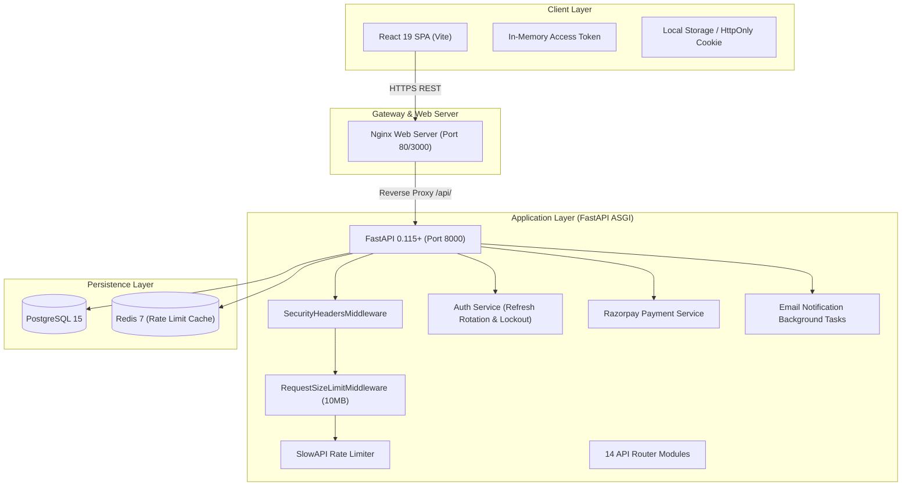

# StudyHub — Full-Stack Academic Learning & Collaboration Platform

[](https://www.python.org/)
[](https://fastapi.tiangolo.com/)
[](https://www.postgresql.org/)
[](https://redis.io/)
[](https://www.sqlalchemy.org/)
[](https://razorpay.com/)
[](https://react.dev/)
[](https://www.docker.com/)
[]()
[]()

> **Production-Ready Enterprise Academic & Collaboration Platform (v2.0.0)**  
> Built with React 19, Python FastAPI, SQLAlchemy 2.0 ORM, PostgreSQL, Redis, Razorpay Payment Gateway, SMTP Email Engine, and JWT Authentication with Refresh Tokens.

---

## 📖 Table of Contents
1. [Overview & Key Capabilities](#-overview--key-capabilities)
2. [Technology Stack](#-technology-stack)
3. [Production Architecture](#-production-architecture)
4. [Demo Accounts for Academic Evaluation](#-demo-accounts-for-academic-evaluation)
5. [Quickstart with Docker Compose](#-quickstart-with-docker-compose)
6. [Local Manual Development Setup](#-local-manual-development-setup)
7. [Running Automated Tests](#-running-automated-tests)
8. [Production Deployment Guide](#-production-deployment-guide)
9. [Production Documentation Index](#-production-documentation-index)

---

## 🎯 Overview & Key Capabilities

StudyHub provides students, faculty, and administrators with an integrated, secure digital educational ecosystem:
- **💳 Razorpay Payment Gateway**: Course purchasing with backend order creation (`/create-order`), cryptographic HMAC-SHA256 signature verification (`/verify`), course pricing, and student billing receipts history. Includes automated sandbox fallback for zero-setup local testing.
- **✉️ Automated Email Notification Engine**: Asynchronous SMTP dispatch (`BackgroundTasks`) with responsive, branded HTML templates for:
  - Welcome email on registration.
  - Course enrollment confirmation with Razorpay transaction receipts.
  - Quiz completion results with score breakdown and pass/fail indicators.
  - Course curriculum update alerts to all enrolled students when new lessons are added.
  - Secure signed password recovery emails.
  *(Gracefully logs formatted email previews to console if live SMTP credentials are not configured).*
- **🔐 Enterprise JWT Authentication & Security**:
  - Short-lived Access Tokens (60 min) + 7-day Refresh Tokens (`/api/v1/auth/refresh`).
  - Axios response interceptor for automatic, seamless token rotation with request retry queue.
  - Time-limited signed Password Reset Tokens (15 min) with frontend reset screens.
  - Password hashing with salted `bcrypt`, account lockout protection, and role-based access control (Student, Instructor, Admin).
- **Course Catalog & Filtering**: Searchable catalog with difficulty, price, and category filters.
- **Student Dashboard**: Aggregated enrollments, lesson progress, quiz attempts, and payment receipts.
- **Curriculum & Learning Workspace**: Structured modules, lessons, notes, and downloadable references.
- **Assessments & Quizzes**: Timed multiple-choice quizzes with strict server-side grading and answer confidentiality.
- **Course Discussion Forum**: Threaded discussions, student replies, and instructor/admin moderation.
- **Instructor Studio**: Course curriculum authoring and quiz creation.
- **Platform Administration**: Platform metrics, user RBAC management, and course moderation.

---

## 🛠 Technology Stack

- **Frontend**: React 19, Vite 8, React Router v7, Axios with JWT Auto-Refresh Interceptors, Lucide Icons, Vanilla CSS Design System.
- **Backend**: Python 3.12, FastAPI, Pydantic v2, PyJWT, bcrypt, SlowAPI, Razorpay SDK, standard `smtplib` & `email.mime`.
- **Database & Cache**: PostgreSQL 15+, Redis 7, SQLAlchemy 2.0 ORM (19 normalized relations), Alembic migrations.
- **Payments**: Razorpay Standard Checkout SDK + Webhooks & SHA256 Signature Verification.
- **Testing**: Pytest (unit/integration/security tests), Vitest & React Testing Library (frontend tests).
- **Deployment**: Docker, Multi-Stage Nginx Frontend, Docker Compose.

---

## 🏛 Production Architecture



---

## 👥 Demo Accounts for Academic Evaluation

The database seed script initializes realistic accounts for each user role:

| Role | Email | Password | Permissions |
| :--- | :--- | :--- | :--- |
| **Student** | `student@studyhub.edu` | `Student@123` | Browse catalog, purchase/enroll, view lessons, take quizzes, view payment receipts. |
| **Student 2** | `student2@studyhub.edu` | `Student@123` | Multi-student enrollment and forum discussion testing. |
| **Instructor** | `instructor@studyhub.edu` | `Instructor@123` | Author courses, organize modules/lessons, create quizzes with answer keys. |
| **Administrator** | `admin@studyhub.edu` | `Admin@123` | Platform metrics, user RBAC management, course moderation. |

---

## 🐳 Quickstart with Docker Compose

Launch the entire stack (PostgreSQL, Redis, FastAPI Backend, and React Frontend) with one command:

```bash
# 1. Copy environment template
cp .env.example .env

# 2. Build and start containers
docker compose up --build -d

# 3. Seed database
docker compose exec backend python -m app.seed
```

- **Frontend**: [http://localhost:3000](http://localhost:3000) or [http://localhost](http://localhost)
- **Backend API Docs**: [http://localhost:8000/docs](http://localhost:8000/docs)
- **Health Check**: [http://localhost:8000/api/v1/health](http://localhost:8000/api/v1/health)

---

## 💻 Local Manual Development Setup

### 1. Backend Setup
```bash
cd backend
python3 -m venv ../.venv
source ../.venv/bin/activate
pip install -r requirements.txt
python -m app.seed
uvicorn app.main:app --host 127.0.0.1 --port 8000 --reload
```

### 2. Frontend Setup
```bash
cd frontend
npm install
npm run dev
```

---

## 🧪 Running Automated Tests

### Backend Test Suite (Pytest)
```bash
cd backend
pytest -v
```
**Tests Include**:
- Health check & database connection
- Password hashing & verification with salted bcrypt
- JWT Authentication (Access tokens, 7-day refresh tokens, token rotation)
- Time-limited signed Password Reset tokens (15 min expiry)
- Duplicate enrollment prevention & role authorization
- Razorpay order creation (`/api/v1/payments/create-order`)
- Cryptographic HMAC-SHA256 signature verification (`/api/v1/payments/verify`)
- Student billing receipts and transaction history (`/api/v1/payments/my-transactions`)
- Quiz answer confidentiality & server-side grading
- Admin role route protection

### Frontend Test Suite (Vitest)
```bash
cd frontend
npm test
```

---

## 🚢 Production Deployment Guide

### Configuration Checklist

| Service | Setting | Description |
| :--- | :--- | :--- |
| **Razorpay** | `RAZORPAY_KEY_ID` | Replace `rzp_test_...` with your live key `rzp_live_...` from the [Razorpay Dashboard](https://dashboard.razorpay.com/#/app/keys). |
| **Razorpay** | `RAZORPAY_KEY_SECRET` | Your live secret key from Razorpay Dashboard. |
| **Email** | `EMAILS_ENABLED` | Set to `True` to enable real outbound email delivery. |
| **Email** | `SMTP_USER` & `SMTP_PASSWORD` | Your SMTP provider credentials (e.g., Gmail App Password or SendGrid API Key). |
| **Security** | `SECRET_KEY` | Generate a cryptographically secure random string: `openssl rand -hex 32`. |
| **CORS** | `CORS_ORIGINS` | Restrict to your production domain (e.g. `https://studyhub.edu`). |

---

## 📚 Production Documentation Index

- [docs/AUTHENTICATION.md](docs/AUTHENTICATION.md) — JWT + Refresh Token Rotation, HttpOnly Cookie Security Model
- [docs/SECURITY.md](docs/SECURITY.md) — Threat Model, OWASP Top 10 Alignment, RBAC Matrix, Security Headers
- [docs/DEPLOYMENT.md](docs/DEPLOYMENT.md) — Docker Compose Dev & Production Runbooks, Nginx Setup
- [docs/ENVIRONMENT_VARIABLES.md](docs/ENVIRONMENT_VARIABLES.md) — Configuration Variable Reference
- [docs/BACKUP_AND_RECOVERY.md](docs/BACKUP_AND_RECOVERY.md) — Database Backup, Restore, and Disaster Recovery
- [docs/TESTING.md](docs/TESTING.md) — Pytest and Vitest Test Suites Guide
- [docs/CONTRIBUTING.md](docs/CONTRIBUTING.md) — Development Workflow and Code Standards
- [CHANGELOG.md](CHANGELOG.md) — Version 2.0.0 Release Notes
