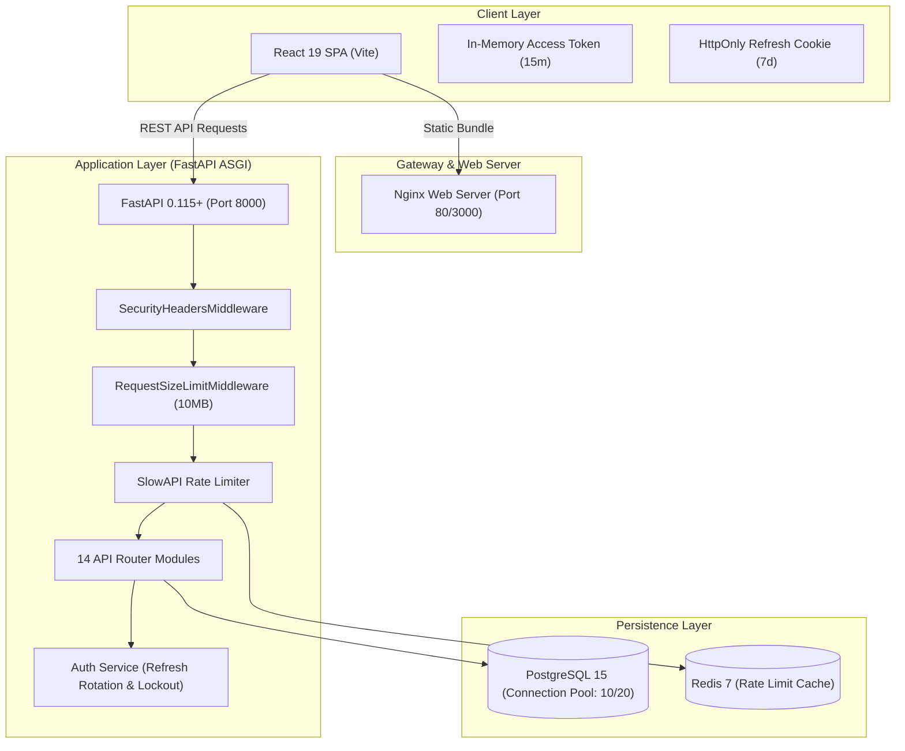

# StudyHub — Full-Stack Academic Learning & Collaboration Platform

[](https://www.python.org/)
[](https://fastapi.tiangolo.com/)
[](https://www.postgresql.org/)
[](https://redis.io/)
[](https://www.sqlalchemy.org/)
[](https://react.dev/)
[](https://www.docker.com/)
[](https://alembic.sqlalchemy.org/)
[]()
[]()

> **Production-Grade Architecture (v2.0.0)**  
> Centralized learning and academic collaboration platform built using React 19, Python FastAPI, SQLAlchemy 2.0, Alembic, PostgreSQL, Redis, and Docker.

---

## 📖 Table of Contents
1. [Overview & Highlights](#-overview--highlights)
2. [Technology Stack](#-technology-stack)
3. [Production Architecture](#-production-architecture)
4. [Demo Accounts for Academic Evaluation](#-demo-accounts-for-academic-evaluation)
5. [Quickstart with Docker Compose](#-quickstart-with-docker-compose)
6. [Local Manual Development Setup](#-local-manual-development-setup)
7. [Running Automated Tests](#-running-automated-tests)
8. [Production Documentation Index](#-production-documentation-index)

---

## 🎯 Overview & Highlights

StudyHub provides students, faculty, and administrators with a secure, highly scalable educational ecosystem:
- **Course Catalog & Filtering**: Searchable catalog with difficulty and category filters, backed by bulk SQL aggregations.
- **Student Dashboard**: Real-time lesson progress tracking, enrolled course metrics, and interactive quiz history.
- **Curriculum & Learning Workspace**: Structured modules, lessons, notes, and downloadable references.
- **Assessments & Quizzes**: Multiple-choice quizzes with strict server-side grading and answer confidentiality.
- **Course Discussion Forum**: Threaded discussions, student replies, and instructor/admin moderation.
- **Instructor Studio**: Course curriculum authoring and quiz creation.
- **Platform Administration**: Platform metrics, user RBAC management, and course moderation.
- **Security & Hardening**: Refresh token rotation, HttpOnly cookies, account lockout, rate limiting, and security headers.

---

## 🛠 Technology Stack

- **Frontend**: React 19, Vite 8, React Router v7, Axios, Lucide Icons, Vanilla CSS Design Token System.
- **Backend**: Python 3.12, FastAPI, Pydantic v2, SlowAPI, PyJWT, bcrypt.
- **Database & Cache**: PostgreSQL 15+, Redis 7, SQLAlchemy 2.0 ORM, Alembic migrations.
- **Infrastructure**: Multi-stage Dockerfiles, Docker Compose (Dev & Prod), Nginx, GitHub Actions CI/CD.
- **Testing**: Pytest (31 unit/integration/security tests), Vitest (5 frontend component/integration tests).

---

## 🏛 Production Architecture



---

## 👤 Demo Accounts for Academic Evaluation

| Role | Email | Password | Access Privileges |
|:---|:---|:---|:---|
| **Administrator** | `admin@studyhub.edu` | `Admin@123` | Full system audit, user role management, system stats |
| **Instructor** | `instructor@studyhub.edu` | `Instructor@123` | Course creation, curriculum authoring, quiz management |
| **Student 1** | `student@studyhub.edu` | `Student@123` | Enrolled in Course 1, quiz attempts, progress tracking |
| **Student 2** | `student2@studyhub.edu` | `Student@123` | Clean student account for enrollment testing |

---

## 🚀 Quickstart with Docker Compose

Run the complete multi-service stack with a single command:

```bash
# Clone the repository
git clone https://github.com/Bhanuprasadh/StudyHub.git
cd StudyHub

# Copy sample environment configuration
cp env.example .env

# Start all services (PostgreSQL, Redis, Backend, Frontend)
docker compose up -d --build

# Run database migrations and load demo seed data
docker compose exec backend alembic upgrade head
docker compose exec backend python app/seed.py
```

Access:
- **Web Application**: [http://localhost:3000](http://localhost:3000)
- **Interactive Swagger Docs**: [http://localhost:8000/docs](http://localhost:8000/docs)
- **ReDoc Documentation**: [http://localhost:8000/redoc](http://localhost:8000/redoc)
- **Health Check Endpoint**: [http://localhost:8000/health](http://localhost:8000/health)

---

## 💻 Local Manual Development Setup

### 1. Backend Setup
```bash
cd backend
python -m venv venv
# Windows:
.\venv\Scripts\activate
# Linux/macOS:
source venv/bin/activate

pip install -r requirements.txt
alembic upgrade head
python app/seed.py
uvicorn app.main:app --reload --port 8000
```

### 2. Frontend Setup
```bash
cd frontend
npm install
npm run dev
```

---

## 🧪 Running Automated Tests

### Backend Tests (31 Passing Tests)
```bash
cd backend
python -m pytest tests/
```

### Frontend Tests (5 Passing Tests)
```bash
cd frontend
npx vitest run
npm run build
```

---

## 📚 Production Documentation Index

- [docs/AUTHENTICATION.md](docs/AUTHENTICATION.md) — JWT + Refresh Token Rotation, HttpOnly Cookie Security Model
- [docs/SECURITY.md](docs/SECURITY.md) — Threat Model, OWASP Top 10 Alignment, RBAC Matrix, Security Headers
- [docs/DEPLOYMENT.md](docs/DEPLOYMENT.md) — Docker Compose Dev & Production Runbooks, Nginx Setup
- [docs/ENVIRONMENT_VARIABLES.md](docs/ENVIRONMENT_VARIABLES.md) — Configuration Variable Reference
- [docs/BACKUP_AND_RECOVERY.md](docs/BACKUP_AND_RECOVERY.md) — Database Backup, Restore, and Disaster Recovery
- [docs/TESTING.md](docs/TESTING.md) — Pytest and Vitest Test Suites Guide
- [docs/CONTRIBUTING.md](docs/CONTRIBUTING.md) — Development Workflow and Code Standards
- [CHANGELOG.md](CHANGELOG.md) — Version 2.0.0 Release Notes
