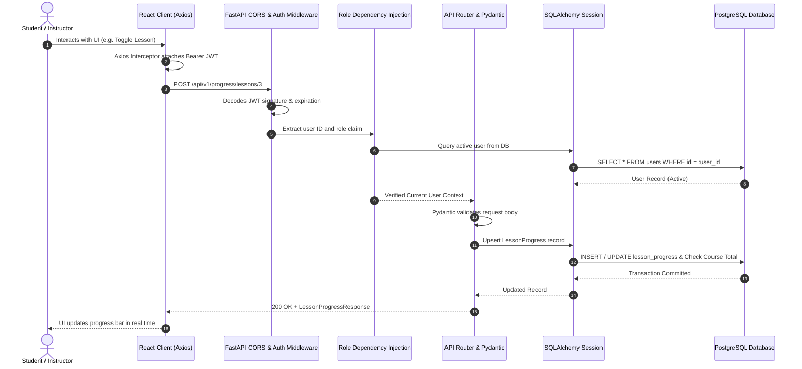

# StudyHub System Architecture Documentation
## M.Tech Academic Project — Full-Stack Web Engineering

---

## 1. Executive Summary

**StudyHub** is an academic learning and collaboration web platform designed to provide students, faculty, and administrators with an integrated digital educational ecosystem. Built as an academic capstone in Full-Stack Web Engineering, the application enforces high cohesion, loose coupling, relational integrity, role-based access control, and defensible engineering patterns.

---

## 2. High-Level System Architecture

The application is structured into a multi-tier decoupled architecture:
1. **Client Tier**: Single Page Application (SPA) built with React 18, React Router v7, and Vanilla CSS design tokens.
2. **API & Business Tier**: Asynchronous RESTful API services powered by Python 3.12 and FastAPI, utilizing Pydantic v2 for strict schema validation and typing.
3. **Data Access & Persistence Tier**: Object-Relational Mapping (ORM) managed by SQLAlchemy 2.0 and version-controlled via Alembic migrations, connecting to an enterprise PostgreSQL relational database.

```mermaid
graph TD
    subgraph Client Tier (React 18 SPA)
        UI[React UI Components]
        Router[React Router v7]
        AuthCtx[Auth Context & Interceptors]
        Axios[Axios HTTP Client]
        UI --> Router
        Router --> AuthCtx
        AuthCtx --> Axios
    end

    subgraph API Tier (FastAPI & Python 3.12)
        CORS[CORS Middleware]
        Security[OAuth2 & JWT Bearer Security]
        RouterAPI[Resource APIRouters]
        Deps[Dependency Injection: get_db, require_role]
        Pydantic[Pydantic v2 Request/Response Validation]
        
        Axios -->|HTTP/REST with Bearer JWT| CORS
        CORS --> Security
        Security --> RouterAPI
        RouterAPI --> Deps
        RouterAPI --> Pydantic
    end

    subgraph Data Tier (PostgreSQL 15+)
        ORM[SQLAlchemy 2.0 ORM Models]
        Engine[Connection Pooling & SessionLocal]
        Alembic[Alembic Migration Engine]
        Postgres[(PostgreSQL Database: studyhub_db)]

        Deps --> Engine
        RouterAPI --> ORM
        ORM --> Engine
        Engine --> Postgres
        Alembic -.->|Schema Versioning| Postgres
    end
```

---

## 3. Technology Stack Justification

| Technology | Role | Justification |
| :--- | :--- | :--- |
| **Python 3.12** | Core Backend Language | Strong typing support, high maintainability, rich ecosystem for data and web engineering. |
| **FastAPI** | REST API Framework | Native ASGI asynchronous support, automatic OpenAPI/Swagger generation, high request throughput, clean dependency injection. |
| **Pydantic v2** | Data Validation & Serialization | Strict runtime type checking, request body parsing, prevention of mass assignment and data leakage. |
| **PostgreSQL 15+** | Relational Database | Strict ACID compliance, native support for complex joins, foreign keys, unique constraints, and B-tree indexing. |
| **SQLAlchemy 2.0** | Object-Relational Mapper | Safe abstraction over SQL queries preventing SQL injection, relationship cascades, and declarative model definitions. |
| **Alembic** | Migration Management | Repeatable, version-controlled database schema evolution ensuring deterministic setups across development and deployment. |
| **React 18** | Frontend Library | Component reusability, virtual DOM performance, unidirectional data flow, declarative UI state management. |
| **Vanilla CSS** | Styling & Design System | Maximum control over CSS variables (design tokens), lightweight footprint, zero CSS runtime overhead, clean responsive design. |
| **Axios** | HTTP Client | Request/response interceptor architecture for transparent JWT header injection and standardized error interception. |
| **Pytest** | Backend Test Suite | Expressive, idiomatic testing framework covering authentication, permissions, database transactions, and business logic. |
| **Vitest & RTL** | Frontend Test Suite | High-speed component rendering tests verifying accessibility and user interaction flows. |

---

## 4. Frontend-to-Backend Request Flow

The diagram below details the complete lifecycle of a secure authenticated request (e.g., student submitting a quiz or toggling a lesson):



---

## 5. Security & Authentication Architecture

1. **Password Hashing**:
   - Plaintext passwords are NEVER stored. Passwords are salted and hashed using `bcrypt` (12 rounds by default).
   - Resistant to rainbow table attacks and brute force.

2. **Stateless Token Authentication (JWT)**:
   - Signed using HMAC-SHA256 (`HS256`) with a server secret key.
   - Contains claims: `sub` (User ID), `role` (Student, Instructor, Admin), `exp` (24-hour expiration timestamp), and `iat`.
   - Token validation occurs on every protected route via FastAPI's `HTTPBearer` / `OAuth2PasswordBearer` dependency.

3. **Role-Based Access Control (RBAC)**:
   - Permissions are strictly enforced on backend endpoints through reusable dependencies:
     - `require_student_or_higher`: Standard authenticated access.
     - `require_instructor`: Restricted to instructors and platform administrators.
     - `require_admin`: Strictly restricted to administrator accounts.
   - Frontend navigation hides unauthorized buttons, but server authorization independently guards every API mutation.

4. **Quiz Answer Confidentiality**:
   - The public quiz endpoint `/api/v1/quizzes/{id}` strips the `is_correct` field from question options using customized response schemas.
   - Answer validation and score computation are performed strictly on the backend server upon submission.
