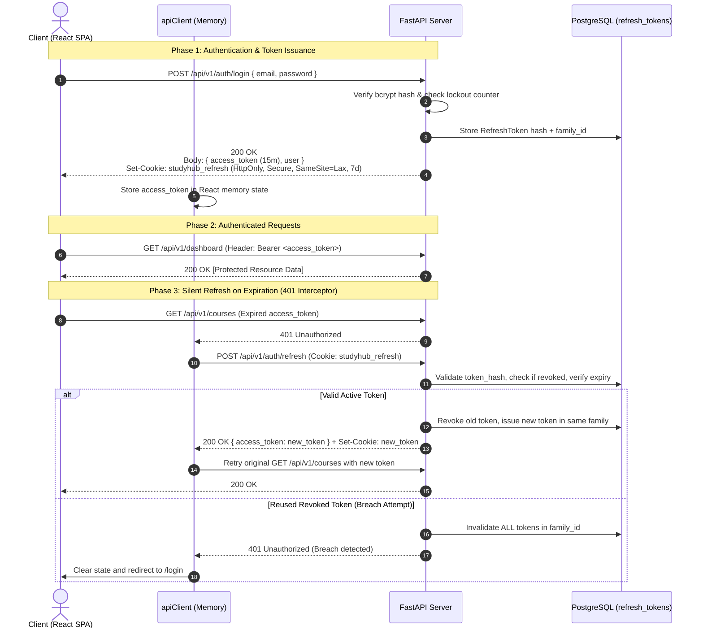

# 🔐 StudyHub Authentication Architecture & Token Strategy

> **Version**: 2.0.0 (Production-Grade) &nbsp;|&nbsp; **Compliance**: OWASP ASVS 4.0

---

## 1. Executive Summary

StudyHub implements a **dual-token authentication model with refresh token rotation**, eliminating the storage of long-lived secrets in client-side persistent storage (`localStorage` / `sessionStorage`) to provide defense against Cross-Site Scripting (XSS) and token theft.

---

## 2. Token Specifications

| Parameter | Access Token | Refresh Token |
|:----------|:-------------|:--------------|
| **Format** | Signed JWT (HMAC-SHA256) | Cryptographically secure random UUIDv4 |
| **Storage Location** | In-Memory (JavaScript heap only) | HttpOnly, Secure, SameSite Cookie |
| **Lifespan** | **15 minutes** | **7 days** |
| **Transmission** | `Authorization: Bearer <token>` | `Cookie: studyhub_refresh=<token>` |
| **Revocation Capability** | Stateless until expiration | Stateful (instant server-side revocation) |
| **XSS Protection** | Not readable if scripts inject after load | 100% immune (JavaScript cannot access HttpOnly cookies) |
| **CSRF Protection** | Bearer header immune to CSRF | SameSite=Lax/Strict + CORS domain enforcement |

---

## 3. Security Features

### 3.1 Refresh Token Rotation & Family Tracking
Every time a refresh token is exchanged via `POST /api/v1/auth/refresh`:
1. The incoming token is immediately invalidated (`revoked = True`).
2. A new refresh token is issued within the same `family_id`.
3. The previous token records the SHA-256 hash of the replacement token (`replaced_by`) for non-repudiation audit trails.

### 3.2 Token Reuse Detection
If an attacker intercepts a refresh token and uses it after the legitimate user has already refreshed:
- The server detects that a **revoked token** is being presented.
- The server instantly executes family-wide revocation: **all active tokens under that `family_id` are revoked immediately**.
- Both the attacker and legitimate client are forced to re-authenticate, eliminating ongoing unauthorized sessions.

### 3.3 Account Lockout Mechanism
To defeat brute-force and credential-stuffing attacks:
- Failed login attempts are incremented on the `users` table (`failed_login_attempts`).
- Upon reaching **5 consecutive failures**, the account is locked for **15 minutes** (`locked_until`).
- Generic error messages (`"Invalid email or password"`) prevent user enumeration.
- Upon successful authentication, `failed_login_attempts` is reset to zero.

### 3.4 Strict Password Policy
Registration rejects weak credentials. Passwords must satisfy:
- Minimum length of **8 characters** (maximum 128 characters)
- At least one **uppercase letter** (`A-Z`)
- At least one **lowercase letter** (`a-z`)
- At least one **decimal digit** (`0-9`)
- At least one **special character** (`!@#$%^&*()_+-=[]{}|;:,.<>?`)

---

## 4. API Endpoints

### `POST /api/v1/auth/login`
- **Request Body**: `{ "email": "...", "password": "..." }`
- **Rate Limit**: 5 requests / minute
- **Response**: `{ "access_token": "...", "token_type": "bearer", "user": { ... } }`
- **Side Effect**: Sets `studyhub_refresh` HttpOnly cookie.

### `POST /api/v1/auth/refresh`
- **Request**: Cookie `studyhub_refresh` (no body required)
- **Rate Limit**: 20 requests / minute
- **Response**: `{ "access_token": "...", "token_type": "bearer", "user": { ... } }`
- **Side Effect**: Rotates cookie to new random UUID.

### `POST /api/v1/auth/logout`
- **Request**: Cookie `studyhub_refresh` and/or Bearer token
- **Response**: `{ "message": "Successfully logged out" }`
- **Side Effect**: Revokes token in database, overwrites cookie with expired max-age 0.

### `POST /api/v1/auth/logout-all`
- **Requirement**: Valid Bearer token
- **Response**: `{ "message": "Logged out of all sessions (N sessions terminated)" }`
- **Side Effect**: Revokes all active refresh tokens belonging to the authenticated user.
