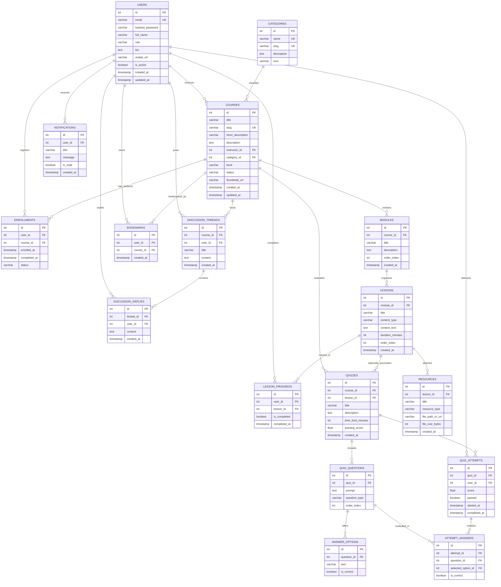

# StudyHub Relational Database Schema & Data Dictionary
## M.Tech Academic Project — Full-Stack Web Engineering

---

## 1. Entity-Relationship (ER) Diagram

The following Mermaid diagram models the entities, primary keys, foreign keys, and cardinalities implemented in PostgreSQL for StudyHub:

---

## 2. Relational Normalization Analysis (1NF, 2NF, 3NF)

### First Normal Form (1NF)
- **Atomicity**: All columns contain scalar, atomic values (e.g., no comma-separated arrays of tags or multi-valued attributes).
- **Primary Keys**: Every table has a clearly defined integer surrogate Primary Key (`id`).
- **No Repeating Groups**: Modules, lessons, and answers are represented in discrete normalized tables linked via Foreign Keys.

### Second Normal Form (2NF)
- The database is in 1NF.
- Every non-prime attribute is fully functionally dependent on the entire primary key. In all entities, tables with composite candidate keys (e.g. `(user_id, course_id)` in enrollments or bookmarks) enforce functional dependency with surrogate primary keys and explicit unique constraints.

### Third Normal Form (3NF)
- The database is in 2NF.
- There are no transitive dependencies: non-key attributes depend only on the primary key, and not on other non-key attributes (e.g., Course does not store redundant instructor email; it holds `instructor_id` referencing `users.id`).

---

## 3. Database Constraints and Integrity Rules

1. **Unique Constraints**:
   - `uq_user_course_enrollment` on `(user_id, course_id)`: Prevents duplicate enrollments by the same student.
   - `uq_user_lesson_progress` on `(user_id, lesson_id)`: Guarantees a student has only one progress state record per lesson.
   - `uq_user_course_bookmark` on `(user_id, course_id)`: Prevents multiple bookmarks of the same course.
   - `users.email` and `categories.slug`: Strictly unique across the platform.

2. **Foreign Key Cascade Deletes**:
   - Deleting a course cascades and removes related modules, lessons, attachments, enrollments, and discussion threads.
   - Deleting a question cascades and deletes its answer options.
   - Deleting a category sets `course.category_id` to `NULL` (`ondelete="SET NULL"`), ensuring courses remain intact even if a category is archived.

3. **Indexes**:
   - Indexed fields: `users.email`, `users.role`, `courses.slug`, `courses.status`, `courses.title`, `enrollments.user_id`, and `idx_course_search` composite index on `(title, level, status)` for sub-millisecond catalog filtering.
